 
 

 

 
 

**Java와 Spring으로 "어긋나면 안 되는 흐름"을 만드는 백엔드 개발자입니다.**

결제 → 매수 주문 파이프라인, 라이브 경매, 실시간 채팅처럼 상태가 꼬이기 쉬운 문제를 좋아합니다. 
배운 것은 [CanaCode](https://canacode.blog)에 기록합니다.

## Tech Stack

<table>
  <tr>
    <td align="right"><b>Language</b></td>
    <td>
      
      
    </td>
  </tr>
  <tr>
    <td align="right"><b>Backend</b></td>
    <td>
      
      
      
      
      
      
      
    </td>
  </tr>
  <tr>
    <td align="right"><b>Data</b></td>
    <td>
      
      
      
    </td>
  </tr>
  <tr>
    <td align="right"><b>Infra</b></td>
    <td>
      
      
      
      
      
    </td>
  </tr>
  <tr>
    <td align="right"><b>Test · Docs</b></td>
    <td>
      
      
      
    </td>
  </tr>
  <tr>
    <td align="right"><b>Tools</b></td>
    <td>
      
      
      
      
      
    </td>
  </tr>
</table>

## Projects

<table>
  <tr>
    <td>
      <h3><a href="https://github.com/Team-Tikkle/Tikkle-be">Tikkle</a></h3>
      <b>Backend</b> &nbsp;·&nbsp; 결제 잔돈 자동 투자 핀테크
      
카드 결제에서 생긴 잔돈을 투자 성향에 맞춰 가상자산 매수로 연결하는 서비스

      <ul>
        <li>결제 알림 수신(HMAC 서명 검증) → 잔돈 계산 → 사용자 승인 → Upbit 입금·매수로 이어지는 주문 파이프라인</li>
        <li>매수 진행 상황을 SSE로 스트리밍하고, 전달하지 못한 결과는 FCM으로 통보</li>
        <li>Spring AI(Gemini · DeepSeek) 기반 가맹점 분류와 투자 후보군 생성</li>
        <li>GCP → AWS 이전, GitHub Actions OIDC + SSM 배포 파이프라인 구축</li>
      </ul>
      <code>Java 21</code> <code>Spring Boot 4</code> <code>JPA</code> <code>MySQL</code> <code>Redis</code> <code>Spring AI</code> <code>SSE</code> <code>FCM</code> <code>AWS</code>
    </td>
  </tr>
  <tr>
    <td>
      <h3><a href="https://github.com/Team-vintib/VINTIB">VINTIB</a></h3>
      <b>Backend</b> &nbsp;·&nbsp; 라이브 경매 빈티지 의류 거래 플랫폼
      
실시간 라이브 · 경매와 AI 가상 시착을 결합한 빈티지 의류 거래 플랫폼

      <ul>
        <li>실시간 경매 — 입찰, 자동 연장, 자동 마감 스케줄러, 낙찰 시 주문 생성과 보류 포인트의 거래 대금 전환</li>
        <li>입찰 포인트 보류·해제 설계와 동시성 경합 테스트로 입찰 정합성 검증</li>
        <li>LiveKit(WebRTC) 라이브 방송, STOMP 기반 시청자 집계와 판매 이벤트 전파</li>
        <li>알림 중복 방지 정책, 배송 상태 추적, 포인트 충전·환불</li>
      </ul>
      <code>Java 21</code> <code>Spring Boot 4</code> <code>JPA</code> <code>PostgreSQL</code> <code>Redis</code> <code>STOMP</code> <code>LiveKit</code> <code>Docker</code>
    </td>
  </tr>
  <tr>
    <td>
      <h3><a href="https://github.com/Team-TripAgora/TripAgora-be">TripAgora</a></h3>
      <b>Backend · 1인 개발</b> &nbsp;·&nbsp; C2C 여행 가이드 매칭 플랫폼
      
SOS 안전 케어와 실시간 소통을 지원하는 여행자 중심 가이드 매칭 플랫폼

      <ul>
        <li>인증, 가이드 프로필, 여행 일정·참여, 리뷰, 위시리스트까지 백엔드 전 도메인 단독 설계·구현</li>
        <li>STOMP 실시간 채팅과 FCM 푸시 알림</li>
        <li>QueryDSL 기반 조회, Testcontainers 통합 테스트</li>
        <li>GitHub Actions 테스트·배포 자동화</li>
      </ul>
      <code>Java 17</code> <code>Spring Boot 3.5</code> <code>JPA</code> <code>QueryDSL</code> <code>MySQL</code> <code>STOMP</code> <code>FCM</code> <code>AWS S3</code>
    </td>
  </tr>
  <tr>
    <td>
      <h3><a href="https://github.com/QuartetTeam/license-hunter-be">자격저격</a></h3>
      <b>Backend</b> &nbsp;·&nbsp; 자격증 정보 플랫폼
      
자격증 정보가 필요한 취업준비생을 위한 웹 서비스

      <ul>
        <li>Spring Security + OAuth2 소셜 로그인(Google · Kakao)</li>
        <li>JWT 액세스 토큰 발급·검증 흐름</li>
        <li>마이페이지 API</li>
      </ul>
      <code>Java 21</code> <code>Spring Boot 3.4</code> <code>Spring Security</code> <code>OAuth2</code> <code>JWT</code> <code>MySQL</code>
    </td>
  </tr>
</table>

## Problem Solving

<picture><source media="(prefers-color-scheme: dark)" srcset="https://raw.githubusercontent.com/canach3/canach3/output/ps-dark.svg" /></picture>

풀이는 <a href="https://github.com/canach3/Algorithm">Algorithm</a> 레포에 자동으로 쌓이고, 위 카드는 그 레포를 집계해 매일 새로 그려집니다.

## Writing

<picture><source media="(prefers-color-scheme: dark)" srcset="https://raw.githubusercontent.com/canach3/canach3/output/blog-dark.svg" /></picture>

자료구조 · 알고리즘 · 백엔드 개발 기록 — <a href="https://canacode.blog">canacode.blog</a>에서 전체 글 보기

## GitHub Activity

<picture><source media="(prefers-color-scheme: dark)" srcset="https://raw.githubusercontent.com/canach3/canach3/output/contrib-3d-dark.svg" /></picture>

<picture><source media="(prefers-color-scheme: dark)" srcset="https://streak-stats.demolab.com?user=canach3&background=0D1117&border=30363D&stroke=30363D&ring=34D399&fire=38BDF8&currStreakNum=E6EDF3&sideNums=E6EDF3&currStreakLabel=34D399&sideLabels=8B949E&dates=8B949E&border_radius=10&card_width=704" /></picture>

<picture><source media="(prefers-color-scheme: dark)" srcset="https://raw.githubusercontent.com/canach3/canach3/output/snake-dark.svg" /></picture>

