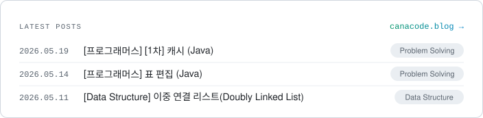
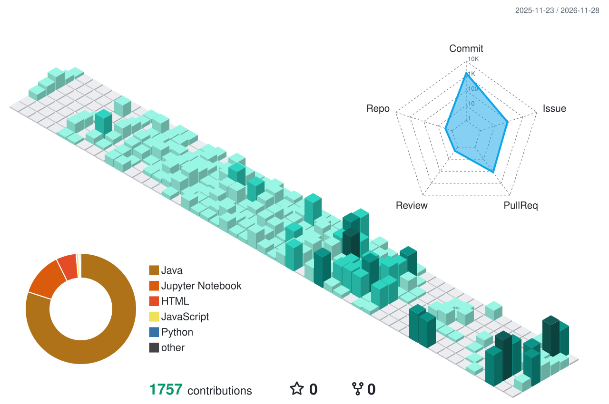

 
 

 

 
 

**고객의 니즈를 읽고, 목적에 맞는 백엔드로 풀어내는 개발자**

비즈니스 요구사항을 정확히 이해하고, 문제의 성격에 맞는 기술을 검증해 구현합니다. 
부하 테스트와 꼼꼼한 회귀 테스트로 장애 없는 안정적인 시스템을 구축합니다.

## Tech Stack

<table>
  <tr>
    <td align="right"><b>Language</b></td>
    <td>
      
      
      
    </td>
  </tr>
  <tr>
    <td align="right"><b>Backend</b></td>
    <td>
      
      
      
      
    </td>
  </tr>
  <tr>
    <td align="right"><b>Data</b></td>
    <td>
      
      
      
    </td>
  </tr>
  <tr>
    <td align="right"><b>Infra</b></td>
    <td>
      
      
      
      
      
    </td>
  </tr>
  <tr>
    <td align="right"><b>Tools</b></td>
    <td>
      
      
      
      
    </td>
  </tr>
</table>

## Projects

<table>
  <tr>
    <td>
      <h3><a href="https://github.com/Team-Tikkle/Tikkle-be">Tikkle</a></h3>
      <b>Backend Lead · AI</b> &nbsp;·&nbsp; 결제 잔돈 자동 투자 핀테크
      
카드 결제에서 생긴 잔돈을 투자 성향에 맞춰 AI 추천 가상자산 매수로 연결하는 서비스

      <ul>
        <li>결제 알림 서명 검증 → 잔돈 계산 → 사용자 승인 → 거래소 Open API 매수로 이어지는 비동기 주문 파이프라인 구축</li>
        <li>웹훅 재전송에 대응해 멱등 키를 도입하고, Redis 선점 락 · DB Unique 제약으로 중복 매수 차단</li>
        <li>외부 API 호출을 DB 트랜잭션에서 분리하고, 낙관적 락과 비동기 체결 폴러로 원장 데이터 정합성 보장</li>
        <li>주문 진행 상황 SSE 스트리밍 · 미수신 시 FCM 푸시 Fallback 및 LLM(Gemini · DeepSeek) 기반 가맹점 분류 구현</li>
        <li>GCP → AWS 마이그레이션, GitHub Actions OIDC · SSM 무중단 배포 및 결제 집중 시간대 Auto Scaling 적용</li>
      </ul>
      <code>Java 21</code> <code>Spring Boot 4</code> <code>JPA</code> <code>MySQL</code> <code>Redis</code> <code>Spring AI</code> <code>Docker</code> <code>AWS</code> <code>Flyway</code>
    </td>
  </tr>
  <tr>
    <td>
      <h3><a href="https://github.com/Team-vintib/VINTIB">VINTIB</a></h3>
      <b>Backend · Infra</b> &nbsp;·&nbsp; 라이브 경매 빈티지 의류 거래 플랫폼
      
실시간 라이브 · 경매와 AI 가상 시착을 결합한 빈티지 의류 거래 플랫폼

      <ul>
        <li>DB Row Lock으로 동시 입찰을 직렬화하고, 알림 · 조회를 트랜잭션 밖으로 분리해 락 점유 시간 최소화</li>
        <li>자동 연장 · 마감 전용 스케줄러 분리 및 낙찰 시 주문 생성 · 보류 포인트 거래 대금 전환 원자적 처리</li>
        <li>k6 · Prometheus · Grafana 기반 부하 측정 체계 구축 및 입찰 p95 지연 · 마감 지연율 단계별 개선</li>
        <li>GitHub Actions Blue/Green 무중단 배포, 7개 컨테이너 자원 재배치 및 HikariCP · STOMP 커넥션 풀 튜닝</li>
        <li>LiveKit(WebRTC) 라이브 방송 · STOMP 이벤트 전파 시 Redis 파이프라인 · 캐싱으로 DB I/O 부하 절감</li>
      </ul>
      <code>Java 21</code> <code>Spring Boot 4.1</code> <code>JPA</code> <code>PostgreSQL</code> <code>Redis</code> <code>Docker</code> <code>Flyway</code> <code>GitHub Actions</code> <code>k6</code>
    </td>
  </tr>
  <tr>
    <td>
      <h3><a href="https://github.com/Team-TripAgora/TripAgora-be">TripAgora</a></h3>
      <b>Backend </b> &nbsp;·&nbsp; C2C 여행 가이드 매칭 플랫폼
      
실시간 채팅 · 위치 공유 · SOS 안전 케어를 지원하는 가이드–여행자 매칭 플랫폼

      <ul>
        <li>정원 초과 방지 시나리오(정원 10명 · 동시 30명) 벤치마크 후 비관적 락과 (사용자, 여행) 복합 유니크 제약 채택</li>
        <li>쿼리 카운트 테스트 기반 N+1 문제 해결 (검색 목록 31 → 3회, 완료 목록 42 → 6회 단축)</li>
        <li>스냅샷 패턴으로 과거 여행 데이터 불변성 보장, DB 롤백 리스크 격리를 위해 S3 업로드 · 삭제 시점을 트랜잭션과 분리</li>
        <li>STOMP 구독 · 발신 인가 단일 JOIN 통합, 실시간 위치 공유 · SOS 및 Testcontainers(MySQL) 252개 회귀 테스트 · PR CI 구축</li>
      </ul>
      <code>Java 17</code> <code>Spring Boot 3.5</code> <code>JPA</code> <code>QueryDSL</code> <code>MySQL</code> <code>AWS S3</code> <code>Testcontainers</code>
    </td>
  </tr>
  <tr>
    <td>
      <h3><a href="https://github.com/QuartetTeam/license-hunter-be">자격저격</a></h3>
      <b>Backend</b> &nbsp;·&nbsp; 자격증 정보 플랫폼
      
자격증 정보가 필요한 취업준비생을 위한 웹 서비스

      <ul>
        <li>OAuth2 소셜 로그인(Google · Kakao) 연동</li>
        <li>JWT 액세스 토큰 발급 · 검증 기반 인증 흐름 구현</li>
        <li>사용자 맞춤형 마이페이지 API 설계 · 구현</li>
      </ul>
      <code>Java 21</code> <code>Spring Boot 3.4</code> <code>JPA</code> <code>MySQL</code>
    </td>
  </tr>
</table>

## Problem Solving

<picture><source media="(prefers-color-scheme: dark)" srcset="https://raw.githubusercontent.com/canach3/canach3/output/ps-dark.svg" /></picture>

풀이는 <a href="https://github.com/canach3/Algorithm">Algorithm</a> 레포에 자동으로 쌓이고, 위 카드는 그 레포를 집계해 매일 새로 그려집니다.

## Writing

<picture><source media="(prefers-color-scheme: dark)" srcset="https://raw.githubusercontent.com/canach3/canach3/output/blog-dark.svg" /></picture>

자료구조 · 알고리즘 · 백엔드 개발 기록 — <a href="https://canacode.blog">canacode.blog</a>에서 전체 글 보기

## GitHub Activity

<picture><source media="(prefers-color-scheme: dark)" srcset="https://raw.githubusercontent.com/canach3/canach3/output/contrib-3d-dark.svg" /></picture>

<picture><source media="(prefers-color-scheme: dark)" srcset="https://streak-stats.demolab.com?user=canach3&background=0D1117&border=30363D&stroke=30363D&ring=34D399&fire=38BDF8&currStreakNum=E6EDF3&sideNums=E6EDF3&currStreakLabel=34D399&sideLabels=8B949E&dates=8B949E&border_radius=10&card_width=704" /></picture>

<picture><source media="(prefers-color-scheme: dark)" srcset="https://raw.githubusercontent.com/canach3/canach3/output/snake-dark.svg" /></picture>

